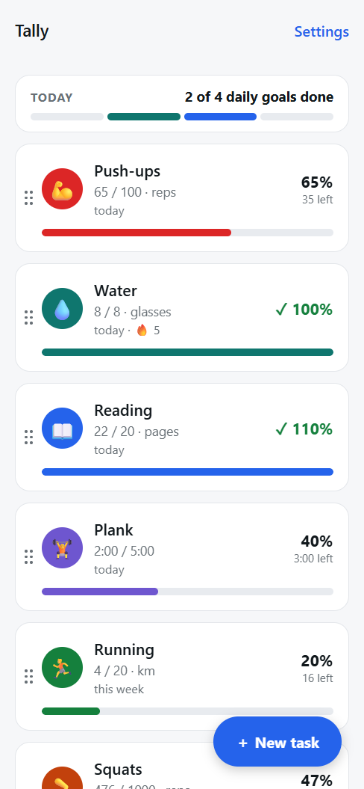
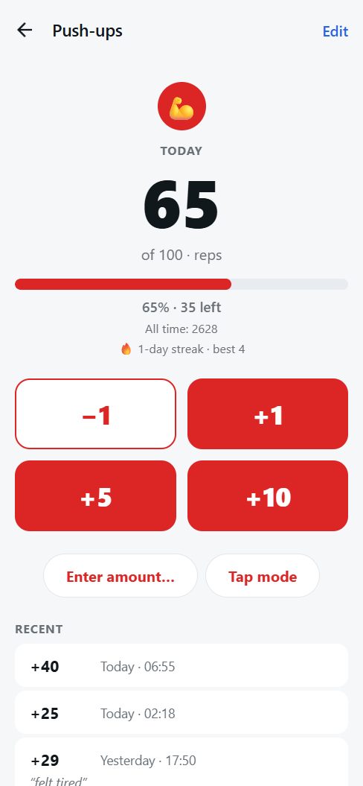
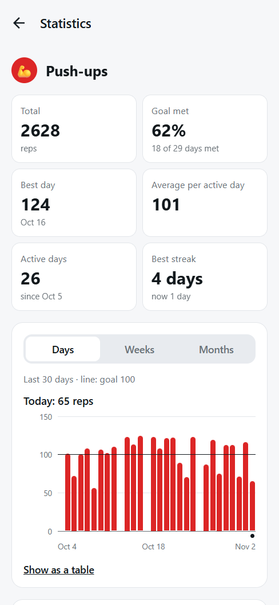
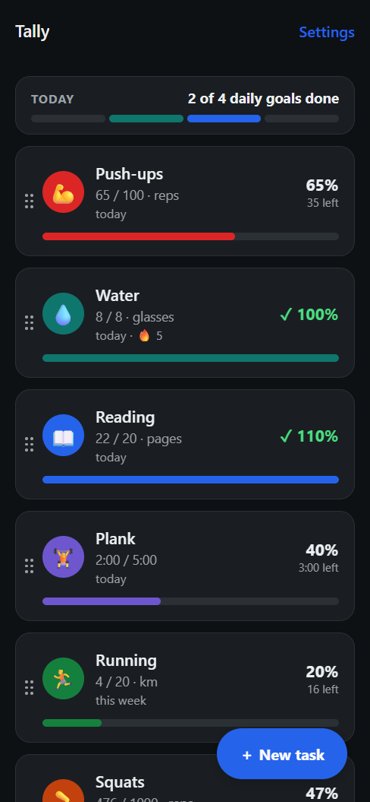

# Tally

A local-first app for counting toward self-set goals: _"1000 push-ups"_, _"100 squats"_. Create a task, tap to log progress, and see how far you are from the target. All data lives in SQLite on the device. It runs on Android and as a Windows program; the iOS code paths (the home-screen widget) exist but have never been built.

Built with Expo SDK 57 (React Native 0.86, TypeScript, Expo Router) and Drizzle ORM over `expo-sqlite`. The full design, decisions and phased plan are in [SPEC.md](SPEC.md).

<p align="center">
  
  
  
  
</p>

<sub>Screenshots of the Windows app in a phone-sized window, with made-up data: the screens are the phone's.</sub>

**Where to start:** [run it on an Android phone](#run-it-on-your-android-phone) · [build an APK](#build-an-installable-apk) · [the Windows app](#windows-app) · [Dropbox sync setup](#dropbox-sync-setup) · [known limitations](#known-limitations) · [the full spec](SPEC.md)

## Status: Phases 0–11

**Counting (Phase 0)**

- Counter screen: big total, the task's own buttons (default −1, +1, +5, +10), "Enter amount…" for any number (negative numbers correct mistakes), Undo, recent entries (long-press to delete)
- Rapid taps merge into one entry: 50 quick taps of +1 are logged as a single "+50"
- Counters can go below zero. Past the target they show more than 100% and a done state.

**Goals (Phase 1)**

- A task is a **total** ("1000 push-ups") or a **quota per day / week / month** ("8 glasses a day"). Daily quotas can skip weekdays ("Mon/Wed/Fri"), and other days show as rest days.
- Optional **deadline / end date**, with "N days left". After it passes, the task moves to **Finished** with its result ("Goal reached", "18 of 30 days met") and becomes read-only. Moving the end date reopens it.
- **Archive** and restore, **edit** every field, delete.
- **History** screen: entries grouped by day with day totals (✓ when a daily quota was met). Tap to edit an amount, long-press to delete.

**Days and settings**

- **New day starts at** (00:00–12:00): a global default, plus an optional per-task override. Logs before the cutoff count for the previous day. Changing a cutoff re-groups past entries (SPEC §3.5).
- **Week starts on**: Auto (from the phone's locale), Monday or Sunday. Weekly quotas re-group immediately.
- **Language**: follows the phone, or English / Русский, including correct Russian plurals ("Остался 21 день", "Выполнено 1 из 21 дня").
- **Theme**: follows the phone, or light / dark. Every text colour is checked for WCAG AA contrast in both themes.
- **Vibration**: off by default. When on, the phone vibrates briefly on every logged change, with a distinct pattern when a goal is reached; switching it on gives a sample buzz. It doesn't affect reminder notifications, which follow Android's settings for the app's notification channel.
- In development builds, Settings has a **clock offset** (+1 h / +1 day) for testing rollover without waiting for it.

**Time and reminders (Phase 2)**

- **Time goals** ("plank 10 minutes a day"): amounts show as `m:ss` / `h:mm:ss`, buttons add minutes, and typed amounts accept `25` (minutes), `1:30` or `1:05:00`. Since Phase 9 you can also pick Hours, Minutes or Seconds and type a plain number (`1.5` hours, `45` seconds).
- **Stopwatch** with pause, resume, stop-and-log and discard. It's stored as timestamps, so it survives the app being backgrounded or killed, and it logs to the day it started. The screen stays on while it runs on the counter screen, and Home shows a banner while one is running. One stopwatch at a time.
- **Reminders** at a per-task time, **skipped when that day's or period's goal is already met** (a total goal: skipped on days you already logged). After every change the app cancels its reminders and plans the next two weeks again, so there's nothing to keep in sync. Tapping a reminder opens its task. Permission is asked for the first time you turn a reminder on, and Settings shows its status.

**Pace, streaks and backup (Phase 3)**

- **Pace** for a total goal with a deadline, or a weekly/monthly quota: "Need 31/day · 37 ahead of pace". Ahead/behind compares your total with an even spread up to the start of today, so the morning never counts as "behind". For time goals both are in whole seconds (the need per day rounded up), not minutes.
- **Streaks**: consecutive met days, weeks or months (rest days don't break them), or consecutive days with anything logged for a total goal. A period still in progress extends a streak but never breaks it. The counter shows current and best; Home cards get a 🔥 badge from 2 in a row.
- **Backup** in Settings. **Export** writes one JSON file (every task and entry, including deletions, plus settings) and opens the share sheet, so it can go to Drive, Telegram or email. **Import** merges a file into the phone: rows are matched by ID and the newer edit wins, so importing the same file twice changes nothing. The whole file is validated first and applied in one transaction, so a damaged file changes nothing. Because a deletion counts as an edit, a task deleted on the phone after the export stays deleted.

**Statistics (Phase 4)**

- A **Statistics** screen per task (from the counter screen):
  - **Tiles:** total, best day, average per active day, active days, best streak, and either the share of days/weeks/months met or progress toward the target.
  - **Bar chart** of the last 30 days, 12 weeks or 12 months, with the goal as a line. Tap or drag to read a bar; every bar has a screen-reader label, and the data is also available as a table.
  - **Calendar heat map:** each day shaded in the task's colour; with a daily goal, the strongest shade means the goal was met.
- The charts are plain views, with no chart library. Their colours are checked in tests: every task colour reaches 3:1 as a mark in both themes, and the four calendar shades step evenly away from the card.

**Order, templates and notes (Phase 5)**

- **Reorder** tasks on Home (since Phase 8 by dragging; see below). Each move rewrites only the moved task's position.
- **Templates:** New task starts with a row of 8 ready-made goals (100 push-ups a day, 1000 squats in 30 days, 8 glasses of water, run 20 km a week, plank 5 min, read 20 pages, cycle 300 km a month, meditate 10 min). Picking one fills the form, and you can change anything before saving.
- **Notes on entries** ("felt tired", "new record"):
  - Add one from the Undo bar right after logging, while typing an amount, by tapping a recent entry, or in History.
  - Quick chips offer your recent notes and a few suggestions.
  - Notes are included in backups, and older backup files without notes still import.

**Quick logging and overview (Phase 6)**

- **Countdown** for time goals: the timer panel switches between Stopwatch and Countdown.
  - The length starts at what's left today (or the pace line's need per day). Change it by a minute with −/+, or tap it to type a time.
  - At 0:00 a notification plays the phone's standard notification sound, and the countdown keeps running as overtime (+0:12). Stop logs the whole time, so holding a plank longer still counts.
  - While Tally is open the alert comes exactly on time. With the app closed it's a scheduled notification, which Android may deliver late (see Known limitations).
- **Tap mode** for count goals: the whole screen becomes a +1 button, for logging in the middle of a set (tap with your nose during push-ups).
  - It shows this set's count and today's progress, and keeps the screen on.
  - Fast taps merge into one entry, like the buttons. A −1 button fixes a stray tap.
- **Today summary** on Home: "3 of 5 daily goals done", with one segment per goal, filled in its colour once met. It counts daily goals that have a quota today, and appears once there are two or more.
- **Do it again** on a finished challenge opens New task with the same settings, starting today and lasting as long as the first run. The finished one stays under Finished.

**Home-screen widgets (Phase 7)** for Android and iOS. The Android widget is tested on the emulator; the iOS one isn't built yet (see Known limitations).

- The widget shows the **first active tasks on Home**: 1 on a small widget, up to 3 on a larger one. Reorder Home to choose them. Each row has the task's progress for today (or this week, month, or in total) and a **+** button that adds the task's smallest button (+1, +5, +1 min). Tapping a row opens that task.
- **Android** (`react-native-android-widget`): + is logged straight into the database, even with the app closed, and presses within 2 s merge into one entry like counter taps. The widget redraws after every change in the app and every 30 minutes, and follows the system's light/dark mode.
- **iOS** (`expo-widgets`, iOS 17+ for the + button): the widget runs apart from the app and can't reach the database. A press is kept in the widget, which shows it right away; the app logs kept presses with their original times the next time it runs. The app gives the widget snapshots for the next few day boundaries, so "today" resets on time.

**Order, icons, colours and the keyboard (Phase 8)**, from user feedback:

- **Drag to reorder:** hold a task card on Home, then drag it to a new place. The list scrolls by itself near the edges. Screen readers get "move up/down" actions on each card instead.
- **Icons:** the quick row of 10 is still there, and **More…** opens a picker with about 230 emoji in 9 categories (sport, health, food, study, work, home, hobbies, nature, symbols). You can also type or paste any emoji.
- **Any colour:** the **+** after the built-in colours opens a picker with a saturation/brightness panel, a hue slider and a HEX field. A custom colour gets its own swatch. Text on task colours (buttons, chips, badges) switches between white and near-black to stay readable, and bars and outlines are nudged to stay visible on the card.
- **Keyboard:** the task form scrolls the focused field above the keyboard, so the counter buttons and their preview stay visible while you type.

**Time input, pace in seconds, sound, and Dropbox sync (Phase 9)**

- **Time in a unit:** wherever you type a time (Enter amount, editing an entry, the countdown length, a time goal's target), a stacked choice offers **h:mm:ss format**, **Hours**, **Minutes** or **Seconds**. With a unit picked, type a plain number: `1.5` or `1,5` hours, `90` seconds. A number typed before picking the unit keeps its digits; a time like `1:30:00` converts to `1.5` hours when that's exact.
- **Pace in seconds** for time goals (see Phase 3).
- **Sound:** reminders and the countdown alert use each platform's standard notification sound (the app ships no sound files). On Android it's the phone's default notification sound, changeable per channel (Reminders, Countdown) in the system settings.
- **Dropbox sync** in Settings. **Connect Dropbox** signs in on Dropbox's own page; Tally never sees the password. After that, sync runs by itself: on launch, when you come back to the app, a few seconds after a change, and when you leave the app with changes not yet uploaded. **Sync now** and **Disconnect** are there too.
  - The data is one file, `tally-sync.json`, in the app's own folder in your Dropbox (Apps). It's the backup format, so the file is also a valid backup for Import.
  - Two devices merge with the backup's rule: rows match by ID and the later edit wins, deletions included. Each device downloads the file, merges it in, and uploads only if the file lacks something, naming the revision it downloaded, so two devices uploading at once can't overwrite each other: the second one merges again and retries.
  - A file that can't be read (damaged, or from a newer Tally) is never overwritten.
  - Disconnecting keeps the data on the phone and the file in Dropbox.

**Windows app (Phase 10)**: the same app as an installable `.exe`. See [Windows app](#windows-app) below.

**Encrypted sync (Phase 11)**: a sync password for the file in Dropbox.

- **Encryption…** in Settings → Dropbox sync opens a window that says what the feature does and what happens to the file already in Dropbox. Type a password twice (at least 8 characters, a phrase is better) and the sync file is encrypted on the device before it's uploaded, so nobody who can see your Dropbox, Dropbox included, can read your tasks and history. **Leave the fields empty and nothing is encrypted**, as before. Leave them empty while encryption is on and it's turned off.
- **The file that's already there** (`tally-sync.json`, unencrypted) is read and merged first, so nothing is lost, then replaced in place by the encrypted one. Dropbox keeps earlier versions of a file for a while (30 days or more, depending on the plan), so the old unencrypted ones stay readable there until they expire; the window says so, and says where to delete them (dropbox.com, version history and deleted files). Backups made with **Export** are separate files and aren't encrypted.
- **Other devices** stop syncing, and say so, until you enter the same password on each: Settings shows "Enter password…". A wrong password is refused without changing anything. Changing the password on one device asks the others for the new one.
- **Forgot it?** There's no recovery: the password isn't kept anywhere, only the key derived from it, on the devices where you entered it. But each device keeps all of its own data, so **I forgot the password** in that window replaces the file in Dropbox with this device's data under a new password (or none). The other devices then ask for the new password and add their data back.
- If the file in Dropbox turns up **unencrypted on a device that expects encryption** (turned off elsewhere, or someone replaced the file), that device does not merge it. It stops and offers **Encrypt it again** or **Stop encrypting here**.
- Key derivation takes a few seconds on a phone (scrypt, 16 MiB; about 4 s in the Android emulator), once per device when the password is entered, with a progress indicator. Syncing itself then takes about a quarter of a second per 700 KB of history.
- Details, the file format and the measurements are in SPEC Phase 11.

## Build an installable APK

The `preview` profile in `eas.json` builds a standalone APK in Expo's cloud (free tier). It needs your own Expo account, and it uploads the project to Expo's build servers:

```bash
npx eas-cli@latest login
```

```bash
npx eas-cli@latest build -p android --profile preview
```

`eas.json` pins the build server to Node 24.13.0 (npm 11), the same versions that write `package-lock.json` locally. With EAS's default (Node 22, npm 10), `npm ci` rejects the lockfile: npm 11 leaves out `@emnapi/core` and `@emnapi/runtime`, which are peer dependencies of an optional WebAssembly package, and npm 10 requires them. If you upgrade Node locally, update the pin to match.

`app.json` carries the author's EAS project ID (`extra.eas.projectId`), which only the author's Expo account can build. **For your own copy, delete that `extra.eas` block and run `npx eas-cli@latest init`** to create your own project; the first build then offers to generate an Android signing key (accept). When it finishes, it prints a link and a QR code for downloading the APK to the phone. The Android package and iOS bundle identifier are the author's too, `com.alishershayakhmetov.taskcounter` (in `app.json`); change them to your own before any store release.

## Run it on your Android phone

1. Install **Expo Go** from the Play Store.
2. Install dependencies and start the dev server:

   ```bash
   npm install
   npx expo start
   ```

3. Scan the QR code in the terminal with Expo Go. The phone and PC must be on the same Wi-Fi network.

If the phone can't connect (Windows Firewall often blocks port 8081), use a tunnel instead:

```bash
npx expo start --tunnel
```

## Scripts

| Command               | What it does                                              |
| --------------------- | --------------------------------------------------------- |
| `npm start`           | Start the Expo dev server                                 |
| `npm test`            | Jest unit tests                                           |
| `npm run typecheck`   | `tsc --noEmit`                                            |
| `npm run lint`        | ESLint (Expo config + Prettier)                           |
| `npm run format`      | Format with Prettier                                      |
| `npm run db:generate` | Generate a SQL migration after editing `src/db/schema.ts` |
| `npm run e2e:build`   | Build a release APK and install it on the emulator        |
| `npm run e2e`         | Run the Maestro end-to-end flows in `.maestro/`           |

CI (`.github/workflows/ci.yml`) runs typecheck, lint, format check and tests. It also fails if the schema changed without a migration, and it bundles the app for Android. A second job, on Windows, runs the Windows app's database tests (which the first job skips, because `desktop/` isn't installed there) and exports its web build.

## Dropbox sync setup

The app talks to Dropbox through an app registered in the [Dropbox App Console](https://www.dropbox.com/developers/apps). Sign-in uses OAuth 2 with PKCE, so the app holds no secret, and the app key is public by design.

The key built into the code (`src/features/sync/dropbox.ts`) belongs to the author's app. **For your own copy, register your own app and use its key**: copy `.env.example` to `.env` and set `EXPO_PUBLIC_DROPBOX_APP_KEY=<your key>`. Expo bakes the value in when the app is bundled, so restart the dev server or rebuild after changing it. Otherwise your sign-ins count toward the author's app's limit, and sync stops if that app is ever removed. Your app needs:

- **Access type:** App folder.
- **Permissions** tab: `files.content.read` and `files.content.write` (then **Submit**). Tokens issued before a permission change don't get it; disconnect and connect again.
- **Settings → OAuth 2 → Redirect URIs:** add both `taskcounter://dropbox-auth` (the phone) and `http://localhost:53682/dropbox-auth` (the Windows app), each with **Add**. Without the right one, Dropbox shows "Invalid redirect_uri" instead of its sign-in page.
- **Allow public clients (Implicit Grant & PKCE):** Allow.

While the Dropbox app is in development status, up to 500 Dropbox accounts can connect it; more need Dropbox's production approval.

## Windows app

`desktop/` is the same app as a Windows program. It's the app's web build (`expo export --platform web`) in an Electron window, so the screens, features and translations are the phone's. Two things differ, because a web page can't do them: SQLite lives in Electron's main process (`better-sqlite3`, the same SQL and migrations), and Dropbox sign-in goes through your default browser.

**Run and build** (needs Node 24; no Visual Studio, because `better-sqlite3` ships a prebuilt binary):

```bash
cd desktop
```

```bash
npm install
```

```bash
npm run build:web
```

```bash
npm start
```

```bash
npm run dist
```

- `build:web` exports the web build into `desktop/web/` (with `TALLY_DESKTOP=1`, which makes Metro swap `expo-sqlite` for `src/desktop/sqlite.ts`; phones and a plain web build are untouched). `start` opens it in Electron.
- `dist` does `build:web` and then packs `desktop/release/`: an installer, `Tally-Setup-<version>.exe` (per user, no admin rights, a folder of your choice), and `Tally-<version>-portable.exe`, which runs without installing. Each is 110–120 MB, because each contains Chromium.
- The installers aren't code-signed, so Windows SmartScreen says "Windows protected your PC" the first time: **More info → Run anyway**. Signing needs a certificate bought from a certificate authority.

**Where things are**

- Data: `%APPDATA%\Tally\task-counter.db` (SQLite, WAL), the same schema as the phone. Back it up from Settings → Backup, or sync it with Dropbox.
- The Dropbox token: `%APPDATA%\Tally\secrets.json`, encrypted with Windows' DPAPI (Electron's `safeStorage`), so it only opens for your Windows user.

**What works:** everything counting-related: tasks, goals, history, statistics, pace and streaks, templates, notes, countdown and stopwatch (visible while the app is open), drag-to-reorder with the mouse (by the dots on a card's left edge) or the keyboard (Alt+↑ / Alt+↓ on a focused card), the emoji and colour pickers, time input in hours/minutes/seconds, backup export (a Save As window) and import, and Dropbox sync. The layout is a centred column up to 720 px wide. The two sideways rows (templates, icon categories) scroll with the mouse wheel and have a scrollbar.

**What doesn't (yet):** reminders and the countdown's 0:00 alert (Windows notifications need their own scheduler, and the app would have to keep running), home-screen widgets, and vibration (the switch is hidden). Settings says so where it applies.

**Dropbox sign-in in the Windows app** works without a URL scheme: Tally opens Dropbox in your browser and listens for a moment on `http://localhost:53682/dropbox-auth` (loopback only), where Dropbox sends the browser back. Port 53682 must be free; if another program has it, Tally says so. The page the browser lands on says it's done and can be closed. **Cancel** stops the wait. Requests to Dropbox are made by Electron's main process, which only talks to `api.dropboxapi.com` and `content.dropboxapi.com`.

**Tests:** `npm run e2e` in `desktop/` starts the app with a throwaway data folder, drives its window with `playwright-core` (it attaches to Electron, so no browser is downloaded) and checks: creating and counting, data kept across a restart, dragging by the handle (also when the pull starts at once), a click and Enter each opening a task once, the wheel scrolling the template row and the icon tabs, a task page being centred, with its header button off the window's edge, export/import with the local time offset, the Dropbox sign-in redirect and Cancel, the bridge's limits, and the whole sync between two app instances against a fake Dropbox (`desktop/e2e/fakeDropbox.mjs`, which answers as Dropbox's API does), encryption included: turning it on, a second device asked for the password, changing it, turning it off, starting over. Run `npm run build:web` first, and add `-- --exe release/win-unpacked/Tally.exe` to test the packaged app. Dropbox itself is never contacted by the tests, so they work offline; the real sign-in and real uploads are the part nobody has tried.

**Safety:** the window has no Node access (`contextIsolation`, `sandbox`), loads only `app://tally/` from the app's own files with a Content-Security-Policy, opens links in your browser, and denies every permission request. Only that page can call the main process's few functions (database, secrets, Dropbox requests, Save As).

## End-to-end tests (Maestro)

The flows in `.maestro/` drive the real release APK on an Android emulator:

| Flow                         | What it checks                                                                                          |
| ---------------------------- | ------------------------------------------------------------------------------------------------------- |
| `01_count_and_undo.yaml`     | Create a task from a template, +1 taps, a typed amount and its Undo, Home's progress                    |
| `02_notes.yaml`              | ADD NOTE from the Undo bar, chips, the note in History, editing it there, removing it                   |
| `03_reorder.yaml`            | New tasks go last, the drag hint, a tap still opens a task, and the order survives a restart            |
| `04_stats_and_settings.yaml` | Statistics tiles and ranges, the Vibration switch (off by default), switching to Russian and back       |
| `05_tap_mode_and_today.yaml` | Tap mode's +1 area and −1, then Home's Today summary as a daily goal is met                             |
| `06_countdown.yaml`          | A typed countdown length, 0:00 turning into overtime, and Stop logging the whole time                   |
| `07_icons_and_colours.yaml`  | An icon from the picker's Food category, a colour typed as HEX, and the task saved with both            |
| `08_time_units.yaml`         | Amounts typed as seconds and hours, the format still working, a countdown length and a target in a unit |

Each flow starts from cleared app data, so they can run in any order. Shared steps live in `.maestro/subflows/`. Flows use English text and the screen-reader labels the app already has (`Add 10`, `Pick any colour`), plus a `testID` where text is ambiguous. Maestro can't hold a press still before moving, so dragging a card is checked by hand with `adb shell input draganddrop`.

**One-time setup** (Windows paths shown):

1. Android Studio's SDK, plus these SDK packages: `platforms/android-36`, `ndk/27.1.12297006`, `cmake/3.22.1`, `system-images/android-36/google_apis/x86_64`. Use Android Studio's SDK Manager, or `cmdline-tools\latest\bin\sdkmanager.bat`.
2. An emulator: `avdmanager create avd -n tally_e2e -k "system-images;android-36;google_apis;x86_64" -d pixel_7`.
3. [Maestro CLI](https://docs.maestro.dev): unzip a release into `%USERPROFILE%\.maestro` and add `%USERPROFILE%\.maestro\maestro\bin` to `PATH`. It needs Java 17 or newer.

**Run:**

```bash
"%LOCALAPPDATA%\Android\Sdk\emulator\emulator.exe" -avd tally_e2e -gpu host
```

Use the GPU (`-gpu host`). With software rendering (`swiftshader`), the emulator lost its adb connection between flows ("device offline").

If every flow stops on the blue splash screen, the emulator's animation state is stuck (seen once, after changing the device date): the splash's fade-out never ends. Setting the scales again fixes it:

```bash
adb shell settings put global animator_duration_scale 1
```

```bash
npm run e2e:build
```

```bash
npm run e2e
```

`e2e:build` generates `android/` (gitignored) with `expo prebuild` if it's missing, builds `assembleRelease`, and installs the APK with `adb`. Add `--clean` after `app.json` or plugin changes. The first build takes a while because Gradle downloads its dependencies; later builds are incremental.

If downloads from `dl.google.com` are slow on your network, set `E2E_GOOGLE_CDN=1`. Gradle then fetches Google's Maven artifacts through Google's alternate CDN (`scripts/google-cdn.init.gradle`): same artifacts and publisher, different host.

## How it works

```text
src/
  app/          screens (Expo Router): index, settings, task/new, task/[id]/{index,edit,history,stats,tap}
  domain/       pure TypeScript, no React/Expo: days, periods, goals, progress, tap merging,
                input validation (error codes, not English text), settings parsing
  db/           Drizzle schema, database client, repositories, re-grouping SQL, useLive()
  features/     screen logic: useCounter, task view models, goal text, the task form, backup, stats charts,
                Dropbox sync (sign-in, HTTP client, the sync round, automatic triggers)
  i18n/         en.json, ru.json, i18next setup, date and error formatting
  lib/          clock (with dev offset), theme hooks, contrast, week start, haptics
  notifications/ reminder scheduling on top of the pure planner in domain/reminders.ts, and the countdown alert
  components/   shared UI: cards, dialogs, calendar, segmented control, steppers
  widgets/      home-screen widgets: AndroidWidget + androidTaskHandler (react-native-android-widget),
                IosWidget (expo-widgets), and index.android.ts / index.ios.ts keeping them in step
index.ts        app entry: Expo Router's entry plus the Android widget's background handler
drizzle/        generated SQL migrations, bundled into the app
assets/         icon.svg (the icon master) and the PNGs exported from it: launcher, adaptive
                foreground and monochrome, notification, splash, favicon
```

- **A count is never stored.** Each change is an entry with a signed amount, and the total is the sum of entries. Undo and history come for free, and Dropbox sync merges two devices without conflicts (SPEC §6.3).
- **Entries keep the moment they were logged and the device's UTC offset.** The day an entry belongs to (`local_date`) is a cache derived from those, so changing a cutoff re-groups history with one SQL statement and never touches `updated_at`. The TypeScript function and its SQL twin are tested against each other on 5,000 random inputs, and the re-grouping statements run in Jest against real SQLite with the actual migrations.
- **Periods are pure date arithmetic** on `YYYY-MM-DD` strings (weeks, months, weekday masks, leap years), so daylight-saving changes can't shift a day.
- **Soft deletes and client-generated UUIDs** throughout, so the local data is ready for sync later.
- The database is opened asynchronously once at startup (migrations run then). After that, queries are synchronous, and screens re-read through `useLive()` whenever a repository writes.
- **Reminders are planned, not polled.** A local notification can't run code when it fires, so "skip if the goal is met" is decided in advance by a pure planner (`domain/reminders.ts`, tested across cutoffs, weekday masks, weeks, months and a DST change). Progress can only change inside the app, and every change re-plans.

## Known limitations

- **A plain browser is not supported**, but the Windows app (above) runs the web build with SQLite swapped for `better-sqlite3`. `expo-sqlite` 57.0.3's web build (alpha) truncates any synchronous result longer than 255 bytes: `web/WorkerChannel.ts` writes the result length with `Uint8Array.set(new Uint32Array([length]))`, which keeps only `length % 256`. Android and iOS use the native module and aren't affected. The Metro `wasm` setting and the cross-origin headers in `app.json` are kept for when this is fixed upstream. Web also needs cross-origin isolation, which `npx expo start` doesn't currently send.
- Verified so far by unit tests, by the Maestro flows on an Android emulator (a release build), and by the Windows app's end-to-end checks. **Not yet run on a real phone**, so Android-only behaviour is unconfirmed: notifications firing, haptics, keeping the screen on, the system dark-mode switch, and `Intl.PluralRules` on Hermes (polyfilled if missing).
- **Reminders** don't exist on web. On Android they use inexact alarms, so they can arrive a few minutes late (exact alarms need a special permission that Android 14 denies by default). They're planned two weeks ahead, so if the app isn't opened for two weeks, they stop until it is.
- **The countdown's 0:00 alert** has the same limit when Tally is closed or the phone is locked: it can arrive late. While the app is open (the counter screen keeps the screen on while a timer runs), the app posts the alert itself, on time.
- **Windows app:** unsigned (SmartScreen warns once), 110–120 MB, no reminders, countdown alert or widgets, and no automatic updates: install the new installer over the old one, and the data stays. Only Windows x64 is built; the same Electron code would run on macOS and Linux, but nothing is packaged or tried there.
- **Encrypted sync:** a forgotten password can't be recovered (start over from a device that has the data). A weak password is weak however it's stored: scrypt at this cost slows guessing but doesn't stop it, so use a long phrase. The size and times of the file are visible to Dropbox, and anyone who can write to your Dropbox can delete or replace the file (a replacement is detected, never silently trusted). Old unencrypted versions stay in Dropbox's history for a while.
- **Dropbox sync** runs only while Tally is open (no background sync), so a change made with the app closed (a widget press on Android) goes up the next time the app runs. The whole file goes up and down each time, which is fine for a personal history but grows with it. "Later edit wins" compares the devices' clocks, so a device with a wrong clock can win when it shouldn't. Sign-in and sync against the real Dropbox haven't been run yet, only against fakes in tests (SPEC Phase 9).
- Header actions ("Settings", "Edit") are text buttons; no icon set is installed.
- **Widgets** need a native build: Expo Go has neither widget module, so there the app runs without them.
  - **Android:** tested on the emulator (see SPEC Phase 7), not yet on a phone. The widget picker shows its English label and the app icon instead of a preview image.
  - **iOS:** can't be built on Windows. It needs a Mac, or an EAS iOS build with an Apple Developer account: the widget shares data through an App Group (`group.com.alishershayakhmetov.taskcounter`), which needs provisioning.
  - **iOS presses** are logged only when the app next runs, so reminders don't know about them until then. A press made in the few milliseconds while the app replaces the widget's timeline is lost.

## License

[MIT](LICENSE), © 2026 Alisher Shayakhmetov.
